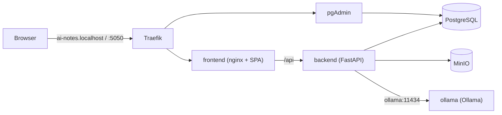

# AI Notes · v1.0.0

Notes, documentation, a blog, projects, boards, tasks and a calendar — in shared
workspaces, with a private AI assistant that runs on your own computer.
Bilingual (English / Persian, LTR / RTL), installable as a PWA, and self-hosted with one command.

## Features

- **Rich notes** – a block editor with `/` commands: headings H1–H6, lists, to-do lists,
  quotes, code blocks with syntax highlighting, tables, dividers, images and videos.
  Media can be aligned left / center / right (text wraps around it) and sized 33–100%.
  Paste or drop files to upload them. Gradient or image covers. Notes up to 2,000,000 characters.
- **AI assistant** (local, via Ollama):
  - *Ask AI* chat over your notes with saved conversation history, a per-chat choice of
    which categories to include, and source links on every answer.
  - Per-note summary (map-reduce for long notes), questions and translation.
  - AI editing inside the editor: improve, fix, shorten, lengthen, simplify, change tone,
    translate, continue writing or a custom instruction, with a preview before applying.
- **Workspaces** – any number per account, each with its own content, categories, theme and
  settings. Invite people by email (owner / admin / editor / viewer) or share a single note,
  board, documentation or project with a registered user.
- **Documents** – multi-page documentation (e.g. "React JS") with nested pages (drag & drop),
  page search, an outline, previous/next links, version history, Markdown export and
  *Ask the docs* (answers with links to the pages). Templates or an AI-planned outline.
- **Blog** – drafts, publishing and scheduling, slugs, excerpt, tags, SEO fields with a
  search preview, featured posts, view counts and an optional public blog per workspace.
- **Projects** – status, priority, timeline with milestones, budget and expenses, team,
  repositories and social links, files in folders, pinned notes, linked board/documentation,
  plus an AI brief, status report and risk analysis.
- **Notion-like editor** – toggle lists, callouts, table of contents, page links, YouTube /
  Aparat / Vimeo / Spotify / SoundCloud / Figma / Maps embeds (paste a link), images, video
  and music by link or upload, files and web bookmarks; a page menu with font style, small
  text, full width, outline, lock, version history, move, import/export (Markdown, HTML,
  PDF) and trash.
- **Boards** (Trello-style) – boards with photo/gradient backgrounds and templates;
  lists and cards with smooth drag and drop (mouse, touch, keyboard); labels, start
  and due dates, rich descriptions, checklists, attachments, covers, comments, archive,
  copy, list colors, card limits, sorting and filters.
- **Drive** (Google Drive-style) – folders and files of any type, drag & drop upload of
  files or whole folders with progress, grid and list views, previews (images, video,
  audio, PDF, text), stars, recent, trash, move by dragging onto a folder, right-click
  menus, folder download as ZIP, sharing with people and public links. Limits (largest
  file, space per workspace, blocked file types) are set in the admin panel.
- **Presentations** – slides edited in place (8 layouts, 8 themes, backgrounds, images),
  speaker notes, drag to reorder, photo slideshows from a set of pictures, background
  music, auto-advance, loop and transitions; full-screen presenter; export to PDF,
  PowerPoint (.pptx) or a self-contained HTML player with the music; AI drafts a deck from a
  topic or a text.
- **Language learning** – flashcard decks with spaced repetition (again / hard / good /
  easy), type-the-word, quiz and listening modes, read-aloud, streaks and an activity
  heatmap; the AI makes cards from a topic or a word list and explains words. **Songs**:
  add a YouTube link or an audio file and the lyrics; lines follow the music with their
  translation (AI translates every line), timed by importing LRC or by "tap to sync";
  repeat a line, slow down, and double-click a word to save it as a flashcard.
- **One search box** – the top bar opens a search window (Ctrl/⌘+K or `/`, like the Tailwind
  docs) over the whole workspace: every section above, categories, chatbot conversations,
  alarms, app pages and actions, and — while the password manager is unlocked — saved
  password names. Words match in any order, Arabic/Persian letter variants and ZWNJ are
  ignored, title matches rank first. On list pages the first result filters the page, so
  no page has its own search box.
- **Alarms** – reminders at a time you choose: once, every day, working days, chosen days
  or monthly; five built-in sounds, snooze, colors and notes; they ring with sound and a
  full-screen reminder (and a system notification when the tab is in the background)
  while the app is open.
- **Sidebar** – drag pages to reorder them (kept per account in the browser).
- **Password manager** – end-to-end encrypted in the browser (PBKDF2 + AES-256-GCM):
  logins, payment cards, Wi-Fi and secure notes; folders, favorites, generator,
  strength meter, a security score with a weak/reused/old password report, auto-lock and
  master-password change.
- **Tasks and calendar** – quick capture, due dates, colored categories, Gregorian or
  Solar Hijri (Jalali) calendar depending on the language.
- **Two languages** – the whole UI, dates, numbers and default data switch between English and
  Persian; Persian uses the Jalali calendar, Persian digits, RTL layout and the Vazirmatn font.
- **Accounts** – email + password, password reset by email, several accounts on one device;
  full profile (name, birth date, phone, address, bio) with a 1:1 cropped photo; list of
  signed-in devices with remote sign-out.
- **Backup** – export everything (including files and encrypted passwords) as one ZIP and
  restore it into any account.
- **Admin panel** – users (enable/disable, admin rights, reset links, delete), the email
  service (Gmail SMTP with a test button), sign-up policy, app URL and an email log.
- **AI everywhere** – a chatbot that answers from the whole workspace by default (notes,
  documents, projects, boards, tasks, the blog, presentations, drive file names, flashcards
  and songs, and — while the password manager is
  unlocked — the names, usernames and sites of saved accounts, never the passwords);
  tasks from text, card and checklist suggestions, documentation outlines, page writing,
  blog titles / excerpt / tags / SEO, project milestones, risks and reports, and a daily
  briefing on the home page. All suggestions are previewed before anything is saved.
- **PWA** – install from the browser, opens in its own window, app shortcuts, offline shell,
  update prompt.
- **Themes** – light / dark / system and 10 accent colors.

## Stack

| Layer | Technology |
|---|---|
| Frontend | React 19, TypeScript 7, Vite 8, TanStack Query 5, React Router, TipTap 3, vite-plugin-pwa |
| Backend | Python 3.13, FastAPI, Pydantic v2, SQLAlchemy 2, Alembic, HTTPX |
| Storage | PostgreSQL 17 (data), MinIO (uploaded images and videos) |
| AI | Ollama (container) with `qwen3.5:4b` |
| Quality | Pytest, Ruff, mypy, Vitest, Testing Library, oxlint, Prettier, GitHub Actions |



## Quick start (Docker)

Requirements: Docker Desktop only — Ollama runs in its own container. Models are read
from `~/.ollama/models` (the Ollama desktop app's folder), so a model you already pulled is
not downloaded again. If you don't have it yet:
`docker compose exec ollama ollama pull qwen3.5:4b`.

```bash
cp .env.example .env          # PowerShell: Copy-Item .env.example .env
# Set PGADMIN_DEFAULT_PASSWORD in .env before starting Compose.
docker compose up --build -d
```

Open http://ai-notes.localhost and create an account. Migrations run automatically on start.
All ports are bound to `127.0.0.1`; nothing is exposed to the network.

Open [pgAdmin](http://localhost:5050) with `PGADMIN_DEFAULT_EMAIL` and
`PGADMIN_DEFAULT_PASSWORD` from `.env`. Select **AI Notes PostgreSQL** and enter
`POSTGRES_PASSWORD` to connect. View the proxy routes in the
[Traefik dashboard](http://localhost:8080/dashboard/).

To install the app: open it in Chrome or Edge and use *Install* in the address bar (or
*Settings → Install app*). On iOS use *Share → Add to Home Screen*.

## Development

```bash
# backend
cd backend
python -m venv .venv && .venv/Scripts/activate   # Linux/macOS: source .venv/bin/activate
pip install -e ".[dev]"
alembic upgrade head          # needs DATABASE_URL (see app/core/config.py)
uvicorn app.main:app --reload

# frontend (proxies /api to localhost:8000)
cd frontend
npm ci
npm run dev
```

| Command | What it does |
|---|---|
| `pytest` · `ruff check .` · `ruff format .` · `mypy app` | Backend tests, lint, format, types |
| `npm test` · `npm run lint` · `npm run format` · `npm run typecheck` | Frontend equivalents |
| `npm run build` | Type check + production build (with service worker) |
| `npm run icons` | Regenerate PWA icons from `public/favicon.svg` |

The backend tests use in-memory SQLite, in-memory file storage and a fake Ollama, so they
need no services. On Windows run Vitest from a path with a lowercase drive letter
(`c:\...`) – an uppercase/lowercase mismatch makes Vitest load itself twice.

## Configuration

All settings are environment variables (see [.env.example](.env.example) and
[backend/app/core/config.py](backend/app/core/config.py)). The most relevant:

| Variable | Default | Meaning |
|---|---|---|
| `OLLAMA_MODEL` | `qwen3.5:4b` | Model name as shown by `docker compose exec ollama ollama list` |
| `OLLAMA_MODELS_DIR` | `~/.ollama/models` | Host folder with the model files, mounted into the `ollama` container |
| `OLLAMA_KEEP_ALIVE` | `30m` | How long the model stays loaded after a request |
| `OLLAMA_TEMPERATURE` | `0.1` | Low = answers stay close to the notes |
| `OLLAMA_NUM_CTX` | `8192` | Context window in tokens |
| `AI_CONTEXT_CHAR_BUDGET` | `12000` | Note characters sent per request |
| `MINIO_*` | see file | Object storage for uploads |
| `UPLOAD_MAX_IMAGE_BYTES` / `UPLOAD_MAX_VIDEO_BYTES` | 20 MB / 500 MB | Upload limits |
| `IMPORT_MAX_BYTES` | 2 GB | Largest backup (uncompressed) that can be restored |
| `APP_URL` | `http://ai-notes.localhost` | Used in links inside emails (also editable in the admin panel) |
| `APP_SECRET_KEY` | empty | Encrypts the stored SMTP password; set a long random value |
| `ADMIN_EMAILS` | empty | Emails that become admins on sign-up (the first account always does) |

### Email (Gmail)

Sign in with the first account (it is the admin), open **Admin panel → Email service**, press
*Use Gmail*, enter your Gmail address and an
[App password](https://myaccount.google.com/apppasswords) (needs 2-Step Verification), turn
on *Send emails* and send a test. Invitations, password resets and share notifications are
then emailed; without it, invitation and reset links are shown to copy instead.

## Project layout

```
backend/
  app/api/        HTTP routes (thin)            app/services/  business logic
  app/models/     SQLAlchemy models             app/schemas/   Pydantic request/response
  app/ai/         Ollama client, retrieval, prompts, translation checks
  app/storage.py  MinIO / in-memory object storage
  alembic/        migrations                    tests/         pytest suite
frontend/src/
  api/            HTTP client, endpoints, React Query hooks
  features/       pages: home, notes, editor, tasks, boards, docs, blog, projects, vault,
                  workspace, sharing, admin, ai, calendar, chat, settings, auth
  i18n/           en (source of truth), fa, error messages
  lib/            calendars (Gregorian/Jalali), markdown, covers, palette
  layout/ components/ hooks/ pwa/ styles/
docs/             design notes (see below)
```

## Documentation

1. [Architecture](docs/01-architecture.md)
2. [API](docs/02-fastapi-rest.md)
3. [Database and storage](docs/03-postgresql-sqlalchemy.md)
4. [Docker and deployment](docs/04-docker.md)
5. [AI: accuracy and grounding](docs/05-ollama-qwen.md)
6. [Frontend, editor, i18n and PWA](docs/06-react.md)
7. [Testing and CI](docs/07-testing-ci.md)
8. [Accounts and security](docs/08-accounts-security.md)
